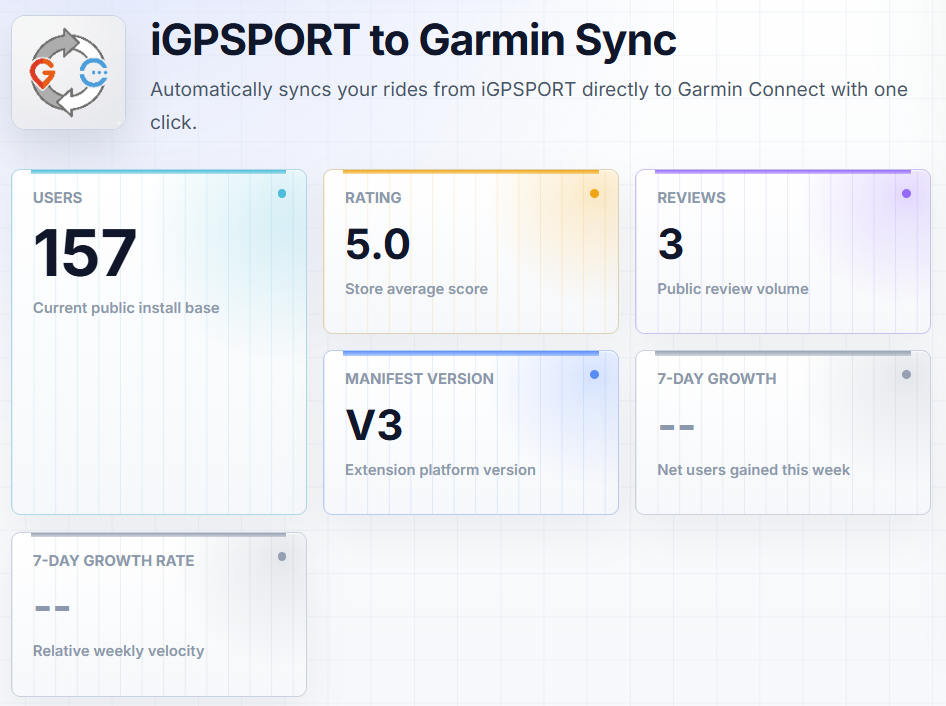

# iGPSPORT to Garmin Sync

Sync your iGPSPORT rides to Garmin Connect in one click.

A Chrome extension for cyclists who record rides with iGPSPORT and want them in Garmin Connect, without downloading and re-uploading `.fit` files by hand.

## Features

- **One-click sync**: Loads your most recent rides from your iGPSPORT dashboard.
- **Choose rides**: Select one or more rides to upload.
- **Automatic transfer**: Downloads each `.fit` file and uploads it to Garmin Connect.
- **Duplicate detection**: Skips rides Garmin Connect already has.

## Requirements

- Desktop Google Chrome
- An iGPSPORT account and a Garmin Connect account, both logged in within the browser

## Install

Get it from the Chrome Web Store:
https://chromewebstore.google.com/detail/igpsport-to-garmin-sync/ianfiekgobcajopadfbflklhdibmhfck

More info: [Softonic](https://igpsport-to-garmin-sync.en.softonic.com/chrome/extension) · [ExtScope](https://extscope.org/extension/ianfiekgobcajopadfbflklhdibmhfck)

## Usage

1. Click the extension icon in Chrome.
2. Log in to iGPSPORT if prompted.
3. Select the rides you want.
4. Click sync. The extension uploads them to Garmin Connect.

## Permissions

- `activeTab`, `scripting`, `tabs`: work with the iGPSPORT and Garmin Connect tabs and run the transfer.
- Site access: `*.igpsport.com`, `*.garmin.com`, `*.aliyuncs.com`.

Ride data moves between iGPSPORT and Garmin Connect inside your browser.

## Limitations

- Runs only in desktop Chrome, while the browser is open and you are logged in.
- Each sync covers the most recent rides shown on your dashboard.
- Depends on the iGPSPORT and Garmin Connect websites. Site changes may require an update.

## Version

1.0.2

## Author

martintn09
